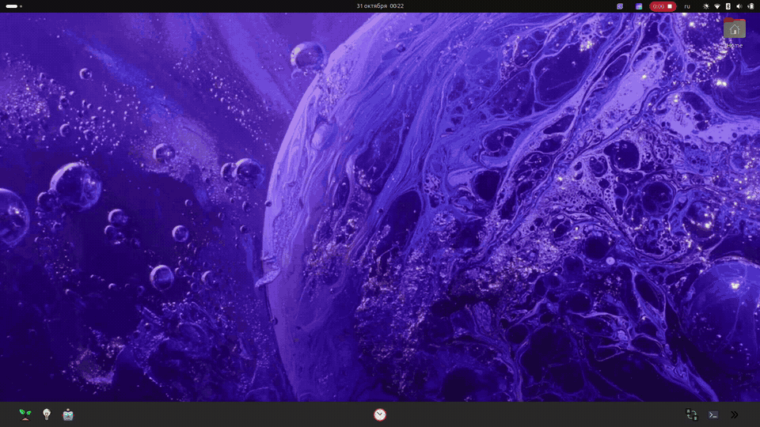

<table align="right">
  <tr>
    <td><b>🇬🇧 English</b></td>
    <td><a href="./README_RU.md">🇷🇺 Русский</a></td>
  </tr>
</table>

## 🛠 Featured Engineering Projects

<table width="100%">
  <tr>
    <td align="center" width="50%">
      
      <h3>
        🕷️<a href="https://github.com/suneids/Hexapod"> Hexapod</a>
      </h3>
      
18 DOF · STM32 · CAN · Inverse Kinematics

    </td>
    <td align="center" width="50%">
      
      <h3>
        🧤 <a href="https://github.com/suneids/Glove">Glove MK2</a>
        +
        <a href="https://github.com/suneids/Car">RC Car MK2.5</a> 🚗
      </h3>
      
STM32 · IMU · Wearable HMI · Radio Control

    </td>
  </tr>
<tr>
    <td colspan="2" align="center">
      
      <h3>
        🖥️ <a href="https://github.com/suneids/Gauntlet">
          Gauntlet
        </a>
      </h3>
      

        Linux · Qt · X11 · IPC · Modbus · Wearable Engineering Platform
      

    </td>
  </tr>
  <tr>
    <td colspan="2" align="center">
      <h3>
        🔧 <a href="https://github.com/suneids/HAL">
          STM32 Low-Level Drivers
        </a>
      </h3>
      

        Register-level drivers · GPIO · UART · SPI ·
        CAN/FDCAN · Modbus RTU · Flash/NVM
      

    </td>
  </tr>
</table>

<table style="width:100%; border:1px solid #30363d;">
<tr><td align="center">

<h2>🛠 Engineering Roadmap: From Sensors to Exoskeletons</h2>

<i>A long-term engineering journey from embedded systems and sensors to cybernetic augmentation. Tracking the evolution from low-level electronics and artificial reflexes to human-machine integration.</i>

</td></tr>

<tr><td>

<h2>🧬 Phase 1: Anatomy (Jul 2025 - Feb 2026) 🏁</h2>

<i>Focus: Sensor Fusion, Bare Metal Basics, Low-Level Protocols</i>

- [x] [**🚗 Project: Car v2.5** — STM32, PWM, Bluetooth / 433 MHz Control](https://github.com/suneids/Car)
- [x] [**🧤 Project: Glove MK2** — MPU6500 Fusion, DMA/ADC, Soft UART, Gesture Recognition](https://github.com/suneids/Glove)
- [x] **🧩 Skill: PCB Design** — 2-layer boards (EMI/EMC focus)

</td></tr>

<tr><td>

<h2>🦿 Phase 2: Biomechanics (Feb 2026 - Feb 2027) 🚀</h2>

<i>Core Track:</i>

&nbsp;&nbsp;⛝&nbsp;&nbsp;~~**🦿 Project: Quadruped (MK1)** — 4-leg movement, basic stability~~ — cancelled, replaced by Hexapod-first path
- [ ] **🕷️ Project: Hexapod (MK1)** — Remote presence, 18-DOF control, IK implementation
      
<i>Support / Infrastructure:</i>

- [x] [**⚡ Project: Laboratory Power Supply Mk1**](https://github.com/suneids/PowerSupply)
- [x] **🧠 Project: Multi-family STM32 HAL — F103 / G0 / G4**
- [x] [**💡 Project: Room Lighting System**](https://github.com/suneids/Light)
- [x] [**🌱 Project: Micro-greenhouse / plant automation platform**](https://github.com/suneids/Greenhouse)
- [ ] [**🖥️ Project: Gauntlet** — Wearable Linux Engineering Terminal](https://github.com/suneids/Gauntlet)
- [ ] **〰️ Project: Inductive flex/tension sensors**

</td></tr>

<tr><td>

<h2>🤖 Phase 3: Advanced Robotics (Feb 2027 - Feb 2028) ⏰</h2>

<i>Focus: Complex Systems, Aesthetics, Advanced Integration</i>

<i>Core Track:</i>
- [ ] **🕷️ Project: Octopod (MK3)** —  High-torque multi-legged robotic platform
- [ ] **🥽 Project: The Mask** — Wearable sensor and feedback system
- [ ] **🦾 Project: The Third Arm** — Shoulder-mounted manipulator platform
- [ ] **🎨 Skill: Cyber-Aesthetics** — Ergonomic mechanical design language
- [ ] **🟩 Skill: PCB Design** — Transition from 2 to 4-layer boards (EMI/EMC focus)

<i>Support / Infrastructure:</i>
- [ ] **🔬 Research: Custom cable-driven tension sensors with integrated encoders**

</td></tr>

<tr><td>

<h2>🧠 Phase 4: Integration (2028 - 2029) ⏰</h2>

<i>Focus: Human-Machine Interface (HMI) & Exoskeletons</i>

- [ ] **🦾 Project: Full Exoskeleton Movement System** — Merging glove control, IK, and high-power actuation into a wearable frame

</td></tr>

<tr><td>

<h2>⚙️ Phase 5: Evolution (2029 - 2030) ⏰</h2>

<i>Focus: Refinement and next-generation iterations</i>

- [ ] **🧤 Project: Glove Mk.3**

</td></tr>
</table>
